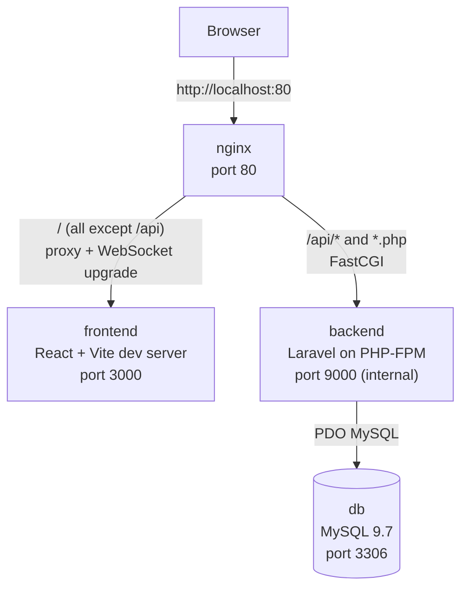
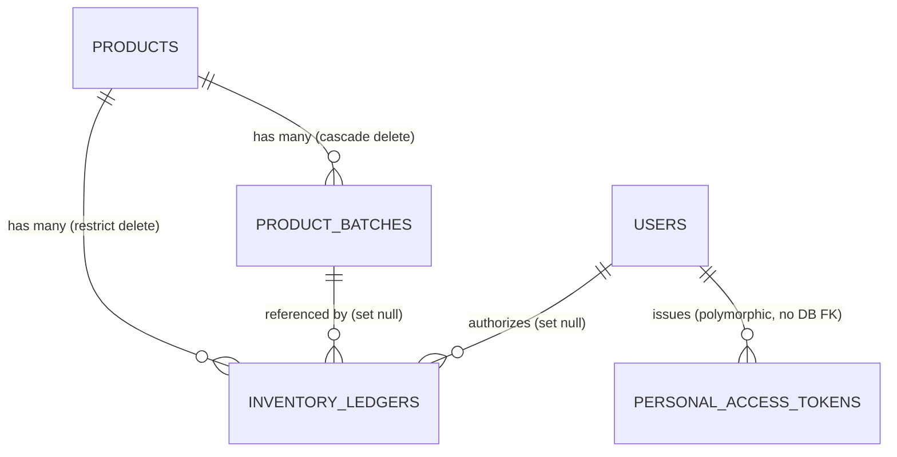

# Walang Brownout Appliances

A web-based inventory management system for Walang Brownout Appliances, built with React, Laravel, and MySQL. It is designed to address seasonal shortages, apply FIFO stock handling, and raise Reorder Point (ROP) alerts.

> **Status: active development.** The Laravel API (authentication, roles, products, batches, receive/dispatch transactions with FIFO, an inventory ledger, dashboard metrics, user management) and the React frontend are both implemented and connected. A few known bugs and gaps remain (most notably, `Product::activeBatches()` is called but not defined; see [Known Issues](#known-issues)). There are no automated tests for the inventory logic yet.

## Table of Contents

1. [Overview](#overview)
2. [Features and Status](#features-and-status)
3. [Architecture](#architecture)
4. [Tech Stack](#tech-stack)
5. [Repository Structure](#repository-structure)
6. [Getting Started](#getting-started)
7. [Makefile Commands](#makefile-commands)
8. [Database](#database)
9. [API Reference](#api-reference)
10. [Authentication and Roles](#authentication-and-roles)
11. [Frontend](#frontend)
12. [Inventory Logic](#inventory-logic)
13. [Testing](#testing)
14. [Git Workflow](#git-workflow)
15. [Troubleshooting](#troubleshooting)
16. [Security Notes](#security-notes)
17. [Known Issues](#known-issues)
18. [Roadmap](#roadmap)
19. [Contributors and License](#contributors-and-license)

## Overview

Walang Brownout Appliances sells appliances such as air conditioners, air purifiers, and filters, whose demand rises sharply in some seasons. This system gives the business one place to see what is in stock, which batch it came from, when it expires, and when to reorder.

The project's goals are to solve **seasonal shortages**, enforce **FIFO**, and automate **Reorder Point (ROP) alerts**. Stock movements are recorded in an append-only **inventory ledger** so every receive and dispatch can be audited.

## Features and Status

Status key: **Done** = implemented in code · **Partial** = implemented with known gaps · **Planned** = not implemented.

| Component | Status | Notes |
| --- | --- | --- |
| Docker environment | Done | 4 services (MySQL, PHP-FPM, Nginx, Vite). Development only; no production config. |
| Authentication API | Done | Register, login, logout, current user (Sanctum bearer tokens). |
| Roles and access control | Done | `admin`, `manager`, `staff`. Manager/admin middleware guards write routes. See [Authentication and Roles](#authentication-and-roles). |
| User management API | Done | Full CRUD at `/api/users` (manager/admin only). |
| Product API | Done | List/show for any authenticated user; create/update/delete for managers. ROP is calculated server-side on save. |
| Product batch API | Partial | `GET` list and show only. `PUT`/`DELETE` routes are registered but have no controller methods. Batches are created through the receive endpoint. |
| Receive stock | Done | `POST /api/transactions/receive` creates a batch and a ledger entry in one DB transaction. |
| Dispatch stock (FIFO) | Partial | `POST /api/transactions/dispatch` drains oldest batches first and writes one ledger row per batch. **Currently depends on the undefined `Product::activeBatches()`**, and does not lock rows or skip expired batches. |
| Inventory ledger | Done | Append-only `inventory_ledgers` table and `GET /api/transactions`. |
| ROP / low-stock alerts | Partial | Dashboard flags products whose active stock is at or below `reorder_point` (also depends on `activeBatches()`). No email or push notification. |
| Expiry monitoring | Partial | Dashboard lists active **Category C** batches expiring within 7 days. Nothing automatically marks batches `expired`. |
| Frontend UI | Done | Login, staff dashboard, manager dashboard, inventory list (add/edit, receive, dispatch), reorder management, reports, user management. All call the API. |
| Frontend route guard | Done | `ProtectedRoute` checks for a stored token and role (UI-level only; the API enforces roles itself). |
| Real-time updates | Planned | Not implemented (`BROADCAST_CONNECTION=log` in `.env.example`). The frontend refetches after its own actions only. |
| Automated tests | Planned | Default Laravel example tests only. |

## Architecture



| Service | Image / build | Host port | Role |
| --- | --- | --- | --- |
| `nginx` | `nginx:alpine` | 80 | Single entry point; routes `/api` to PHP-FPM and everything else to the frontend |
| `frontend` | `node:20-alpine` (`frontend/DOCKERFILE`) | 3000 | Vite dev server (also proxies `/api` to `nginx`) |
| `backend` | `php:8.4-fpm` (`docker/php/DOCKERFILE`) | none (9000 internal) | Laravel API |
| `db` | `mysql:9.7` | 3306 | Database |

All services share the `app-network` bridge network. `./backend` and `./frontend` are bind-mounted for live editing. There is no MySQL data volume and no health check.

## Tech Stack

Versions are the ranges declared in `composer.json`, `package.json`, and the Docker files.

| Layer | Technology | Version |
| --- | --- | --- |
| Frontend | React, React DOM | ^19.2.8 |
| Routing | react-router-dom | ^7.18.3 |
| Build tool | Vite, @vitejs/plugin-react | ^8.2.0, ^6.0.4 |
| Styling | Tailwind CSS 4, FlyonUI | ^4.3.3, ^2.4.1 |
| Icons | lucide-react | ^1.42.0 |
| Linting | oxlint | ^1.7.5 |
| Backend | Laravel, PHP | ^13.8, ^8.3 (image `php:8.4-fpm`) |
| API auth | Laravel Sanctum | ^4.0 |
| Testing | PHPUnit | ^12.5.12 |
| Database | MySQL | 9.7 |
| Web server / containers | Nginx, Docker Compose | `nginx:alpine` |
| Frontend runtime | Node.js | 20 |

## Repository Structure

```text
WalangBrownout/
├── backend/                       # Laravel API
│   ├── app/Http/Controllers/      # Auth, User, Product, ProductBatch, InventoryLedger, Dashboard
│   ├── app/Http/Middleware/       # EnsureManagerOrAdmin (alias: manager)
│   ├── app/Models/                # User, Product, ProductBatch, InventoryLedger
│   ├── app/Services/              # ReorderPointService (currently unused)
│   ├── database/migrations/       # Schema
│   ├── database/seeders/          # Demo users, products, batches, ledger entries
│   ├── routes/api.php             # API routes
│   ├── tests/                     # Default example tests only
│   └── .env.example
├── frontend/                      # React + Vite app
│   ├── src/App.jsx                # Route table
│   ├── src/api.js                 # API client, token header, simple GET cache
│   ├── src/components/            # DashboardLayout, Sidebar, ProtectedRoute, AuthCard, ...
│   └── src/pages/                 # Screens
├── docker/
│   ├── nginx/default.conf         # Routing rules
│   └── php/DOCKERFILE
├── docker-compose.yml
├── Makefile
├── .vscode/mcp.json               # FlyonUI MCP server (prompts for a license key)
└── package.json                   # Root Tailwind/FlyonUI dependencies
```

## Getting Started

**Prerequisites:** Git and Docker with Docker Compose (Docker Desktop on Windows/macOS). GNU Make is optional. PHP, Composer, and Node.js run inside the containers, so you do not need them installed.

```bash
git clone https://github.com/reiy-git/WalangBrownout.git
cd WalangBrownout
```

**1. Create the backend environment file** (`backend/.env` is git-ignored):

```bash
cp backend/.env.example backend/.env      # PowerShell: Copy-Item backend/.env.example backend/.env
```

`.env.example` defaults to SQLite. To use the MySQL container, set these in `backend/.env`, using the values from the `db` service in `docker-compose.yml`:

```dotenv
DB_CONNECTION=mysql
DB_HOST=db
DB_PORT=3306
DB_DATABASE=app_db
DB_USERNAME=app_user
DB_PASSWORD=<MYSQL_PASSWORD value from docker-compose.yml>
```

`DB_HOST` must be `db` (the service name), not `127.0.0.1`.

**2. Start the containers and verify:**

```bash
docker compose up -d --build
docker compose ps
```

**3. Install backend dependencies, generate the key, migrate, and seed** (`backend/vendor/` is git-ignored):

```bash
docker compose exec backend composer install
docker compose exec backend php artisan key:generate
docker compose exec backend php artisan migrate
docker compose exec backend php artisan db:seed
```

Seeding is needed to log in, because the app has no sign-up screen. It creates demo accounts, products, batches, and ledger entries (see [Demo accounts](#demo-accounts)).

The frontend installs its dependencies at image build time and starts the Vite dev server automatically.

**4. Open the app:** <http://localhost> (recommended; API at <http://localhost/api>). Port 3000 also works: the Vite dev server proxies `/api` to the `nginx` container.

### Demo accounts

The seeder creates these users. **All use the password `password`. They are for local development only; never seed them in a shared or production environment.**

| Email | Role |
| --- | --- |
| `test@example.com` | manager |
| `admin@walangbrownout.ph` | admin |
| `staff@example.com` | staff |
| `ron.canayong@example.com` | staff |
| `claire.delacruz@example.com` | staff |

## Makefile Commands

| Command | Purpose |
| --- | --- |
| `make setup` | `up -d --build`, then `key:generate`, then `migrate` (does **not** create `.env`, run `composer install`, or seed; do those first/after) |
| `make up` / `make down` | Start / stop containers |
| `make restart` | `down`, then `up -d --build` |
| `make logs` | Follow logs for all services |
| `make backend-shell` / `make frontend-shell` | Open a shell in the backend (`bash`) / frontend (`sh`) container |
| `make migrate` | Run `php artisan migrate` |

## Database

Migrations create the framework tables (`password_reset_tokens`, `sessions`, `cache`, `cache_locks`, `jobs`, `job_batches`, `failed_jobs`, `personal_access_tokens`) plus the application tables below.

**`products`** (PK `id`)

| Field | Type | Notes |
| --- | --- | --- |
| `sku` | varchar(50) | Unique (DB index and API validation) |
| `name` | varchar(255) | |
| `unit_cost` | decimal(10,2) | |
| `abc_category` | enum `A`, `B`, `C` | Default `B` |
| `expiry_months` | int | Default shelf life used when receiving stock without an expiry date |
| `reorder_point` | int | **Recomputed by the server on every create/update** (see [Inventory Logic](#inventory-logic)) |
| `safety_stock` | int | |
| `annual_demand` | decimal(10,2) | |
| `last_reorder_date` | date, nullable | |
| `created_at`, `updated_at` | timestamps | |

**`product_batches`** (PK `id`; FK `product_id` → `products.id`, `ON DELETE CASCADE`)

| Field | Type | Notes |
| --- | --- | --- |
| `product_id` | unsigned bigint | Parent product |
| `batch_number` | varchar(100) | |
| `date_received` | date | Used for FIFO ordering |
| `quantity_received` | int | |
| `quantity_remaining` | int | Decremented by dispatch |
| `expiry_date` | date | |
| `status` | enum `active`, `depleted`, `expired` | Dispatch sets `depleted`; nothing sets `expired` automatically |
| `created_at`, `updated_at` | timestamps | |

**`inventory_ledgers`** (PK `id`; append-only audit log, no `updated_at`)

| Field | Type | Notes |
| --- | --- | --- |
| `product_id` | FK → `products.id` | `RESTRICT` on delete |
| `product_batch_id` | FK → `product_batches.id`, nullable | `SET NULL` on delete |
| `user_id` | FK → `users.id`, nullable | `SET NULL` on delete |
| `transaction_type` | string | `receive` or `dispatch` |
| `quantity` | int | Units moved in this entry |
| `timestamp` | timestamp, indexed | |

**`users`**: `id`, `name`, `email` (unique), `role` (string, default `staff`), `active` (boolean, default `true`), `email_verified_at`, `password` (hashed), `remember_token`, timestamps.



## API Reference

Base URL: `http://localhost/api`. Send `Accept: application/json`. Protected routes need `Authorization: Bearer <token>`. Errors under `/api` are always JSON; validation failures return 422.

**Access levels:** *Public* = no token · *Auth* = any logged-in user (staff, manager, admin) · *Manager* = `manager` or `admin` role (403 otherwise).

| Method | Endpoint | Access | Purpose |
| --- | --- | --- | --- |
| POST | `/register` | Public | Create a `staff` user, returns `user` and `token` (201) |
| POST | `/login` | Public | Returns `user` and `token`; 401 on bad credentials |
| POST | `/logout` | Auth | Revoke the current token |
| GET | `/user` | Auth | Authenticated user |
| GET | `/v1/dashboard/summary` | Auth | KPI cards: total products, low-stock count, expiring-soon (Category C) count, total inventory value |
| GET | `/v1/dashboard/panel1?limit=10` | Auth | Recent ledger entries |
| GET | `/v1/dashboard/panel2` | Auth | `reorder_alerts` and `expiry_alerts` |
| GET | `/products` | Auth | List products with `batches` (not paginated) |
| GET | `/products/{product}` | Auth | Show product with `batches` |
| POST | `/products` | Manager | Create product (201); `reorder_point` is calculated server-side |
| PUT/PATCH | `/products/{product}` | Manager | Update product; `reorder_point` is recalculated |
| DELETE | `/products/{product}` | Manager | Delete product (batches cascade; fails if ledger entries exist) |
| GET | `/product-batches` | Manager | List batches with `product` |
| GET | `/product-batches/{product_batch}` | Manager | Show batch with `product` |
| GET | `/transactions?limit=50` | Auth | Recent ledger entries, newest first |
| POST | `/transactions/receive` | Auth | Receive stock: creates a batch and a `receive` ledger entry (201) |
| POST | `/transactions/dispatch` | Auth | Dispatch stock using FIFO across active batches; one `dispatch` ledger entry per batch touched |
| GET, POST | `/users`, `/users/{user}` (+ PUT/PATCH/DELETE) | Manager | User CRUD |

`POST /product-batches` does not exist; batches are created via `/transactions/receive`. `PUT`/`DELETE` on `/product-batches/{id}` are routed but have no controller methods (see [Known Issues](#known-issues)).

**Validation rules**

| Endpoint | Rules |
| --- | --- |
| `POST /register` | `name` required string; `email` required, valid, unique; `password` required, min 8 |
| `POST /login` | `email` required, valid; `password` required |
| `POST /products` | `sku` required, max 50, unique; `name` required, max 255; `unit_cost` numeric ≥ 0; `abc_category` in `A,B,C`; `expiry_months`, `safety_stock` integer ≥ 0; `annual_demand` numeric ≥ 0; `reorder_point` optional integer ≥ 0 (ignored, then overwritten); `last_reorder_date` optional date |
| `PUT/PATCH /products/{id}` | Same fields, each optional (`sometimes`); SKU uniqueness ignores the current record |
| `POST /transactions/receive` | `product_id` exists; `supplier` required string; `quantity` integer ≥ 1; `notes`, `batch_number`, `expiry_date` optional |
| `POST /transactions/dispatch` | `product_id` exists; `department` required string; `quantity` integer ≥ 1; `notes` optional. Returns 422 if requested quantity exceeds active stock |
| `POST /users` | `name`, `email` (unique), `password` min 6, `role` in `admin,manager,staff`, optional `active` boolean |

**Quick manual test** (replace placeholders; never commit real tokens):

```bash
# 1. Log in with a seeded account and copy the token from the response
curl -X POST http://localhost/api/login -H "Accept: application/json" -H "Content-Type: application/json" \
  -d '{"email":"test@example.com","password":"password"}'

# 2. Create a product (manager token)
curl -X POST http://localhost/api/products -H "Accept: application/json" -H "Content-Type: application/json" \
  -H "Authorization: Bearer <token>" \
  -d '{"sku":"AC-001","name":"Air Condition Split Type","unit_cost":25000,"abc_category":"A","expiry_months":24,"safety_stock":5,"annual_demand":120}'

# 3. Receive stock for it (use the returned product id)
curl -X POST http://localhost/api/transactions/receive -H "Accept: application/json" -H "Content-Type: application/json" \
  -H "Authorization: Bearer <token>" \
  -d '{"product_id":<id>,"supplier":"Acme Supply","quantity":20}'

# 4. Dispatch some of it (FIFO)
curl -X POST http://localhost/api/transactions/dispatch -H "Accept: application/json" -H "Content-Type: application/json" \
  -H "Authorization: Bearer <token>" \
  -d '{"product_id":<id>,"department":"Sales","quantity":5}'
```

## Authentication and Roles

The backend uses **Laravel Sanctum personal access tokens** (bearer tokens), not cookie sessions. Register and login each create a token named `auth_token` and return it. Logout deletes only the token used for that request. Tokens do not expire by default (`expiration` is `null` in `config/sanctum.php`). Passwords are hashed by the `User` model's `hashed` cast and checked with `Hash::check`.

| Role | Can do |
| --- | --- |
| `staff` | View products, view the dashboard and ledger, receive and dispatch stock |
| `manager` | Everything staff can, plus create/edit/delete products, view batches, and manage users |
| `admin` | Same as manager (the `manager` middleware accepts `manager`, `admin`, and `administrator`) |

Roles are enforced on the server by the `manager` middleware (`EnsureManagerOrAdmin`). The frontend also hides manager pages from staff, but that is a convenience, not the security boundary.

## Frontend

React 19 + `react-router-dom`, styled with Tailwind 4 and FlyonUI. State is local component state; there is no global store. `src/api.js` wraps `fetch`, attaches the bearer token from `localStorage`, and keeps a small in-memory cache for GET requests that is cleared after related mutations.

| Path | Page | Access | Notes |
| --- | --- | --- | --- |
| `/`, `/login`, `/manager-login` | `LoginPage` (via `AuthCard`) | Public | Calls `POST /login`, stores `auth_token`, `user_role`, `user_name` in `localStorage`, then redirects by role |
| `/dashboard` | `Dashboard` | All roles | Staff landing page: KPIs, recent transactions, alerts |
| `/inventory-list` | `ManagerInventoryList` | All roles | Product list with search/filters; add/edit products, receive and dispatch stock |
| `/manager-dashboard` | `ManagerDashboard` | Manager/admin | KPIs, recent ledger, reorder and expiry alerts |
| `/reorder-points` | `ManagerReorderManagement` | Manager/admin | Reorder point management |
| `/reports` | `ManagerReports` | Manager/admin | Reports from products and transactions |
| `/users` | `ManagerUserManagement` | Manager/admin | List, create, edit, delete users |

`StaffLogin.jsx` and `LoginRoleSelection.jsx` still exist but are not routed (the unified `LoginPage` replaced them).

## Inventory Logic

| Concept | Status | Behavior |
| --- | --- | --- |
| FIFO | Partial | Dispatch loads active batches ordered by `date_received` then `id`, takes from each until the requested quantity is met, marks emptied batches `depleted`, and writes one ledger row per batch. See the caveats in [Known Issues](#known-issues). |
| Reorder Point | Done (calculation) / Partial (alerts) | `ROP = round((annual_demand / 365 × multiplier × lead_time_days) + safety_stock)`, with `multiplier = 1.5` for category A (else `1.0`) and `lead_time_days = 7`. Computed in `ProductController` on every create/update. A product is "low stock" when total active-batch stock ≤ `reorder_point`; the alert is `critical` when stock ≤ `safety_stock`, otherwise `warning`. |
| Safety stock, annual demand | Done | Inputs to the ROP formula and the critical-alert threshold. |
| ABC category | Partial | Category A gets the 1.5× seasonal demand multiplier. Category C is the only category included in expiry alerts. |
| Expiry | Partial | Receiving without an `expiry_date` defaults to `expiry_months` (or 12 months if 0) from today. The dashboard lists active Category C batches expiring within 7 days. No job marks batches `expired`, and dispatch does not skip expired batches. |
| Stock movement | Done | Receive and dispatch run in database transactions and write immutable ledger entries. |
| Inventory value | Done | Sum of `quantity_remaining × unit_cost` over active batches. |

## Testing

- **PHPUnit:** configured (in-memory SQLite) but only the two default example tests exist. Run: `docker compose exec backend php artisan test`.
- **Frontend:** no tests. Lint with `docker compose exec frontend npm run lint`.
- **API / end-to-end tests:** none. The API is verified manually with an HTTP client (curl, Postman, Thunder Client).
- **Highest-value tests to add first:** multi-batch FIFO dispatch, insufficient-stock rejection, receive creating batch + ledger, and the `manager` middleware returning 403 for staff.

## Git Workflow

```text
main  ←  develop  ←  feature/<feature-name>
```

- **`main`**: production branch.
- **`develop`**: shared integration branch.
- **`feature/*`**: one branch per task, created from `develop`. **Pull Requests target `develop`, not `main`.**

```bash
git checkout develop
git pull origin develop
git checkout -b feature/<feature-name>
# ...work and test locally...
git add .
git commit -m "feat: <description>"
git push origin feature/<feature-name>
```

Then open a Pull Request into `develop`, request a review, address comments, and merge once approved.

**Commit prefixes:** `feat:` new feature · `fix:` bug fix · `docs:` documentation · `refactor:` restructuring without behavior change · `test:` tests · `chore:` maintenance such as dependency updates.

## Troubleshooting

| Problem | What to do |
| --- | --- |
| **Port 3306 in use** | Find the process: `Get-NetTCPConnection -LocalPort 3306` then `Get-Process -Id <OwningProcess>`. If it is the local Windows MySQL service, confirm with `Get-Service MySQL80` and, only if it is the conflict and you do not need it, run `Stop-Service MySQL80` (admin PowerShell). Or change the host port in `docker-compose.yml` (e.g. `"3307:3306"`). Ports 80 and 3000 can conflict the same way. |
| **`vendor/autoload.php` not found** | `docker compose exec backend composer install` |
| **No application encryption key** | `docker compose exec backend php artisan key:generate` |
| **DB connection refused / wrong DB** | Check `backend/.env` has `DB_CONNECTION=mysql` and `DB_HOST=db`; then `php artisan config:clear` in the backend container. |
| **Migrate fails right after startup** | MySQL may still be initializing (no health check). Wait a few seconds and retry. |
| **Can't log in** | Run `php artisan db:seed`; there is no sign-up screen. Use a [demo account](#demo-accounts). |
| **500 "Call to undefined method ... activeBatches()"** | Known bug: add the relation to `Product` (see [Known Issues](#known-issues)). Affects dispatch and dashboard alerts. |
| **Changed `frontend/package.json`** | Rebuild: `docker compose up -d --build frontend` (the container keeps its own `node_modules`). |
| **API calls fail** | Check `docker compose ps` and the backend logs. Browse via `http://localhost`; `:3000` also works through the Vite proxy. |
| **Check containers** | `docker compose ps`, `docker compose logs -f <service>` (or `make logs`). |

## Security Notes

Present: Sanctum token auth on protected routes, server-side role middleware for write routes, hashed passwords, inline input validation, `$fillable` mass-assignment protection, an append-only audit ledger, and `backend/.env` / `.env` in `.gitignore`.

Be aware (not verified as secure):

- Never commit `.env` files, passwords, tokens, or credentials.
- `docker-compose.yml` contains plain-text development database passwords; move them to environment files before any shared or production use.
- The seeder creates accounts with the password `password`. Do not run it outside local development.
- `POST /api/register` is public. New accounts get the `staff` role, but that still allows anyone to obtain a token and post stock transactions. Remove or restrict it for real use.
- Login returns different messages for an unknown email ("No user found!") and a wrong password, which reveals which emails are registered. The `active` flag on users is not checked at login.
- Tokens do not expire, and `.env.example` sets `APP_DEBUG=true` (development only).
- The frontend stores the token in `localStorage`, which is readable by any script on the page.
- `.vscode/mcp.json` prompts for a FlyonUI license key at runtime; do not paste the key into the file.

## Known Issues

The items below were found by reading the code; they have not all been reproduced at runtime.

**Bugs**

1. **`Product::activeBatches()` is not defined.** `InventoryLedgerController::dispatch` and `DashboardController::panel2` call it, but `Product` only defines `batches()`. Fix: add `public function activeBatches(): HasMany { return $this->batches()->where('status', 'active'); }` to `app/Models/Product.php`.
2. **`PUT`/`PATCH`/`DELETE /product-batches/{id}` are routed but unimplemented.** `ProductBatchController` only has `index` and `show`, so these routes return an error. Either add the methods (and write ledger entries for quantity changes) or restrict the routes to `only(['index', 'show'])`.
3. **Deleting a product that has ledger history fails** with a raw database error, because ledger rows use `RESTRICT`. Return a friendly 409 or use soft deletes.
4. **Client-supplied `reorder_point` is ignored.** The server always recomputes it, so manual changes made on the reorder-management screen are overwritten on save. Decide whether ROP is calculated or editable.

**Inventory logic gaps**

5. **Dispatch has no row locking.** Two simultaneous dispatches can read the same stock and oversell it. Use `lockForUpdate()` inside the transaction.
6. **Dispatch does not skip expired batches**, although the code comments say it should, and nothing flips `status` to `expired`.
7. **ROP logic is duplicated** in `ProductController`, `ReorderPointService` (unused), and `DatabaseSeeder`, with hard-coded lead time (7 days) and category A multiplier (1.5).
8. **Batch quantities are not cross-checked:** nothing enforces `quantity_remaining ≤ quantity_received` or `expiry_date` after `date_received`.
9. **Expiry alerts cover Category C only**, with a fixed 7-day window.

**Setup and tooling**

10. `make setup` is incomplete on a fresh clone (no `.env`, no `composer install`, no seed), and `.env.example` targets SQLite while Docker provides MySQL.
11. No MySQL data volume: `docker compose down -v` deletes all data.
12. There are no automated tests for FIFO, ROP, receive/dispatch, or role checks.
13. `StaffLogin.jsx` and `LoginRoleSelection.jsx` are unused leftovers.
14. `frontend/README.md` and `backend/README.md` are the default Vite and Laravel template READMEs.

## Roadmap

**Completed:** Docker environment; Sanctum auth and roles; user, product, and batch read APIs; receive/dispatch transactions with an inventory ledger; dashboard metrics; frontend connected to the API.

**Next (recommended order):**

1. Add `Product::activeBatches()` and verify dispatch and dashboard alerts end to end.
2. Add row locking and expired-batch handling to dispatch.
3. Close or restrict public registration.
4. Centralize ROP in `ReorderPointService` and make lead time and multipliers configurable.
5. Write feature tests for FIFO, receive, and role middleware.
6. Fix the batch-route mismatch and product deletion behavior.

**Planned:** scheduled expiry monitoring, notifications for low stock, real-time visibility, expanded reports, production build and deployment configuration.

## Contributors and License

**Contributors:** Project Team · repository owner [reiy-git](https://github.com/reiy-git). Reiy Briones is the lead developer; Raissa Capistrano and Marriyell Burgos are the frontend developers; Ron Norman Canayong and Angelo Castillo are the backend developers.

**License:** no license has been specified for this project. (The Laravel skeleton in `backend/` is MIT-licensed; that does not define this project's license.)
