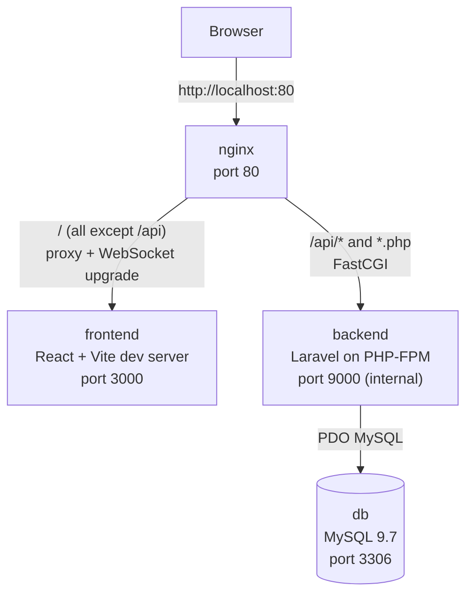
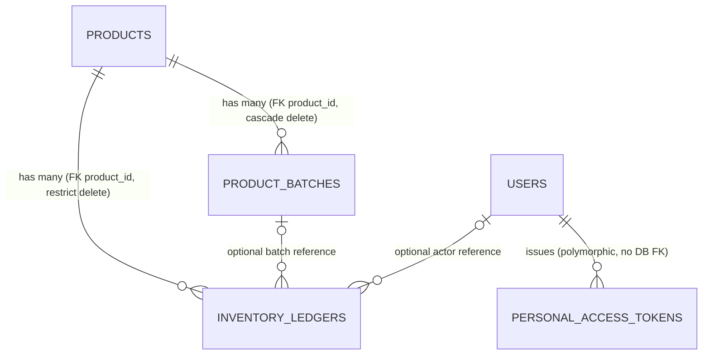

# Walang Brownout Appliances

A web-based inventory management system for Walang Brownout Appliances, built
with React, Laravel, MySQL, and Docker. The repository includes API-backed
authentication, product and batch management, FIFO receiving/dispatch, a stock
ledger, reorder/expiry alerts, dashboards, reports, and user-management screens.
It also supports manager-configured seasonal demand multipliers and overstock
thresholds, plus manager/admin physical-count reconciliation with ledger audit.
Seasonal forecasting and automatic season scheduling are not implemented.

## Table of Contents

1. [Overview](#overview)
2. [Features and Status](#features-and-status)
3. [Architecture](#architecture)
4. [Tech Stack](#tech-stack)
5. [Repository Structure](#repository-structure)
6. [Getting Started](#getting-started)
7. [Makefile Commands](#makefile-commands)
8. [Database](#database)
9. [API Reference](#api-reference)
10. [Authentication](#authentication)
11. [Frontend](#frontend)
12. [Inventory Logic](#inventory-logic)
13. [Testing](#testing)
14. [Git Workflow](#git-workflow)
15. [Troubleshooting](#troubleshooting)
16. [Security Notes](#security-notes)
17. [Known Issues](#known-issues)
18. [Roadmap](#roadmap)
19. [Contributors and License](#contributors-and-license)

## Overview

Walang Brownout Appliances sells appliances such as air conditioners, air purifiers, and filters, whose demand rises sharply in some seasons. This system is meant to give the business one place to see what is in stock, which batch it came from, when it expires, and when to reorder.

The project's goals are to reduce **seasonal shortages**, enforce **FIFO**, and
provide **Reorder Point (ROP) and stock alerts**. FIFO, configurable seasonal
factors, optional overstock limits, and auditable physical-count adjustments
are implemented; see [Inventory Logic](#inventory-logic).

## Features and Status

Implemented · In development / partial · Planned

| Component | Status | Notes |
| --- | --- | --- |
| Docker environment | Implemented (development) | MySQL, PHP-FPM, Nginx, Vite; no production hardening. |
| Authentication | Implemented | Laravel Sanctum bearer tokens and role-aware React routes. |
| Inventory API/UI | Implemented | Products, batches, receive/dispatch operations, FIFO batch allocation. |
| Inventory controls | Implemented (configured rules) | ROP, manager-configured seasonal multipliers and optional overstock thresholds, expiry alerts, FIFO, and audited count reconciliation. |
| Ledger and reports | Implemented (baseline) | Inventory movements are recorded and shown in dashboards/reports. |
| Automated tests | Implemented (feature coverage) | PHPUnit covers batch eligibility, FIFO dispatch, insufficient stock, dashboard alerts, seasonal ROP, count audit/authorization, and disabled direct batch mutation routes. |
| Collaboration evidence | Team-dependent | Reviews, commits, and tested integration must reflect actual contributions. |

## Architecture



| Service | Image / build | Host port | Role |
| --- | --- | --- | --- |
| `nginx` | `nginx:alpine` | 80 | Single entry point; routes `/api` to PHP-FPM and everything else to the frontend |
| `frontend` | `node:20-alpine` (`frontend/DOCKERFILE`) | 3000 | Vite dev server |
| `backend` | `php:8.4-fpm` (`docker/php/DOCKERFILE`) | none (9000 internal) | Laravel API |
| `db` | `mysql:9.7` | 3306 | Database |

All services share the `app-network` bridge network. `./backend` and
`./frontend` are bind-mounted for live editing. Compose logs Laravel output to
stderr, and a Docker-managed framework volume holds Laravel runtime files.
MySQL readiness is checked before the backend starts. Configure a persistent
database volume before using this development stack for any environment whose
database contents must survive container recreation.

## Tech Stack

Versions are the ranges declared in `composer.json`, `package.json`, and Docker files.

| Layer | Technology | Version |
| --- | --- | --- |
| Frontend | React, React DOM | ^19.2.8 |
| Routing | react-router | ^8.3.0 |
| Build tool | Vite, @vitejs/plugin-react | ^8.2.0, ^6.0.4 |
| Styling | Tailwind CSS 4, FlyonUI | ^4.3.3, ^2.4.1 |
| Linting | oxlint | ^1.7.5 |
| Backend | Laravel, PHP | ^13.8, ^8.3 (image `php:8.4-fpm`) |
| API auth | Laravel Sanctum | ^4.0 |
| Testing | PHPUnit | ^12.5.12 |
| Database | MySQL | 9.7 |
| Web server / containers | Nginx, Docker Compose | `nginx:alpine` |
| Frontend runtime | Node.js | 20 |

## Repository Structure

```text
WalangBrownout/
├── backend/                  # Laravel API
│   ├── app/Http/Controllers/ # AuthController, ProductController, ProductBatchController
│   ├── app/Models/           # User, Product, ProductBatch
│   ├── database/migrations/  # Schema
│   ├── routes/api.php        # API routes
│   ├── tests/                # Default example tests
│   └── .env.example
├── frontend/                 # React + Vite app
│   ├── src/App.jsx           # Route table
│   ├── src/api/auth.js       # login() helper (unused by pages so far)
│   └── src/pages/            # Screens
├── docker/
│   ├── nginx/default.conf    # Routing rules
│   └── php/DOCKERFILE
├── docker-compose.yml
├── Makefile
└── package.json              # Root Tailwind/FlyonUI dependencies
```

## Getting Started

**Prerequisites:** Git and Docker with Docker Compose (Docker Desktop on Windows/macOS). GNU Make is optional. PHP, Composer, and Node.js run inside the containers, so you do not need them installed.

```bash
git clone https://github.com/reiy-git/WalangBrownout.git
cd WalangBrownout
```

**1. Create the backend environment file** (`backend/.env` is git-ignored):

```bash
cp backend/.env.example backend/.env      # PowerShell: Copy-Item backend/.env.example backend/.env
```

`.env.example` is configured for the local MySQL service. Keep these values
aligned with the `db` service in `docker-compose.yml`:

```dotenv
DB_CONNECTION=mysql
DB_HOST=db
DB_PORT=3306
DB_DATABASE=app_db
DB_USERNAME=app_user
DB_PASSWORD=app_password
```

`DB_HOST` must be `db` (the service name), not `127.0.0.1`.

**2. Start the containers and verify:**

```bash
docker compose up -d --build
docker compose ps
```

**3. Install backend dependencies, generate the key once, and apply migrations**
(`vendor/` is a Docker-managed volume; the Compose setup installs dependencies):

```bash
docker compose exec backend composer install
docker compose exec backend php artisan key:generate   # first setup only; never replace a key in use
docker compose exec backend php artisan migrate --force
docker compose exec backend php artisan db:seed --force     # optional local demo data only
```

The frontend installs its dependencies at image build time and starts the Vite dev server automatically.

**4. Open the app:** <http://localhost> (recommended, API at <http://localhost/api>). Port 3000 serves the frontend only; it does not proxy `/api`.

## Makefile Commands

| Command | Purpose |
| --- | --- |
| `make setup` | Build/start containers, install Composer dependencies, generate `APP_KEY` only if empty, then apply pending migrations; create `backend/.env` first |
| `make up` / `make down` | Start / stop containers |
| `make restart` | `down`, then `up -d --build` |
| `make logs` | Follow logs for all services |
| `make backend-shell` / `make frontend-shell` | Open a shell in the backend (`bash`) / frontend (`sh`) container |
| `make migrate` | Apply pending migrations without dropping existing data |
| `make seed` | Load local demo users and inventory; never use in production |

## Database

Migrations create these tables: `users`, `password_reset_tokens`, `sessions`, `cache`, `cache_locks`, `jobs`, `job_batches`, `failed_jobs`, `personal_access_tokens` (Sanctum), `products`, `product_batches`, and `inventory_ledgers`. The application tables are below; the rest are standard Laravel framework tables.

**`products`** (PK `id`, unsigned int)

| Field | Type | Notes |
| --- | --- | --- |
| `sku` | varchar(50) | Unique database index and API validation |
| `name` | varchar(255) | |
| `unit_cost` | decimal(10,2) | |
| `abc_category` | enum `A`, `B`, `C` | |
| `expiry_months` | int | |
| `reorder_point` | int | |
| `safety_stock` | int | |
| `annual_demand` | decimal(10,2) | |
| `seasonal_demand_multiplier` | decimal(4,2) | Manager-configured factor, 0.1–5; existing Category A items retain 1.5 |
| `max_stock_level` | unsigned int, nullable | Optional threshold for overstock alerts |
| `last_reorder_date` | date, nullable | |
| `created_at`, `updated_at` | timestamps | |

**`product_batches`** (PK `id`, unsigned int; FK `product_id` → `products.id`, `ON DELETE CASCADE`)

| Field | Type | Notes |
| --- | --- | --- |
| `product_id` | unsigned int | Parent product |
| `batch_number` | varchar(100) | |
| `date_received` | date | |
| `quantity_received` | int | |
| `quantity_remaining` | int | |
| `expiry_date` | date | |
| `status` | enum `active`, `depleted`, `expired` | Set by receiving, dispatch, and count reconciliation operations; batch API update/delete is disabled |
| `created_at`, `updated_at` | timestamps | |

**`inventory_ledgers`** (append-only stock movement history; product deletion is restricted, batch/user deletion sets the respective nullable reference to `NULL`)

| Field | Type | Notes |
| --- | --- | --- |
| `id` | unsigned bigint | Primary key |
| `product_id` | unsigned bigint | Required product reference |
| `product_batch_id`, `user_id` | nullable unsigned bigint | Optional batch and actor references |
| `transaction_type` | varchar | `receive`, `dispatch`, or `count_adjustment` |
| `quantity` | int | Received/dispatched quantity or signed count delta |
| `timestamp` | timestamp | Indexed movement time |
| `notes` | text, nullable | Count-adjustment reason |
| `quantity_before`, `quantity_after` | int, nullable | Count audit values; null for ordinary movements |

**`users`**: `id`, `name`, `email` (unique), `email_verified_at`, `password` (hashed), `remember_token`, timestamps.



## API Reference

Base URL: `http://localhost/api`. Send `Accept: application/json`. Protected routes need `Authorization: Bearer <token>`. Errors under `/api` are always JSON; validation failures return 422.

| Method | Endpoint | Auth | Purpose |
| --- | --- | --- | --- |
| POST | `/register` | No | Create user, returns `user` and `token` (201) |
| POST | `/login` | No | Returns `user` and `token`; 401 on bad credentials |
| POST | `/logout` | Yes | Revoke the current token |
| GET | `/user` | Yes | Authenticated user |
| GET | `/products` | Yes | List products with `batches` (not paginated) |
| POST | `/products` | Manager/Admin | Create product (201) |
| GET | `/products/{product}` | Authenticated | Show product with `batches` |
| PUT/PATCH | `/products/{product}` | Manager/Admin | Update product |
| DELETE | `/products/{product}` | Manager/Admin | Delete product (batches cascade; ledger references restrict deletion) |
| GET | `/product-batches` | Manager/Admin | List batches with `product` (not paginated) |
| GET | `/product-batches/{product_batch}` | Manager/Admin | Show batch with `product` |
| POST | `/product-batches/{productBatch}/count` | Manager/Admin | Reconcile counted quantity; requires reason and writes before/after audit values |
| POST | `/transactions/receive` | Authenticated | Receive stock into a new batch and write a ledger entry |
| POST | `/transactions/dispatch` | Authenticated | Dispatch available stock using locked FIFO batches |
| GET | `/transactions` | Authenticated | List the latest 1–100 stock ledger movements |
| GET | `/v1/dashboard/summary`, `/v1/dashboard/panel1`, `/v1/dashboard/panel2` | Authenticated | Dashboard metrics, reorder, expiry, and configured overstock alerts |

**Validation rules**

| Endpoint | Rules |
| --- | --- |
| `POST /register` | `name` required string; `email` required, valid, unique; `password` required, min 8 |
| `POST /login` | `email` required, valid; `password` required |
| `POST /products` | `sku` required, max 50, unique; `name` required, max 255; `unit_cost` numeric ≥ 0; `abc_category` in `A,B,C`; `expiry_months`, `reorder_point`, `safety_stock` integer ≥ 0; `annual_demand` numeric ≥ 0; optional `seasonal_demand_multiplier` 0.1–5 (default 1); optional nullable `max_stock_level` integer ≥ 0 |
| `POST /product-batches/{productBatch}/count` | Manager/Admin only; `quantity` required integer ≥ 0; `reason` required string length 3–1000; atomically updates batch and writes signed delta plus before/after values to the ledger |
| `POST /transactions/receive` | `product_id` must exist; `supplier` required; `quantity` integer ≥ 1; optional notes, batch number, expiry date |
| `POST /transactions/dispatch` | `product_id` must exist; `department` required; `quantity` integer ≥ 1; only active, unexpired, positive-quantity stock can be dispatched |
| `PUT/PATCH /products/{product}` | Product fields are optional (`sometimes`); SKU uniqueness ignores the current record |

Batch quantity changes cannot be performed through batch update/delete routes; use receive, FIFO dispatch, or manager/admin count reconciliation to preserve the ledger trail.

**Quick manual test** (replace placeholders; never commit real tokens):

```bash
# 1. Register or log in, and copy the token from the response
curl -X POST http://localhost/api/login -H "Accept: application/json" -H "Content-Type: application/json" \
  -d '{"email":"you@example.com","password":"<your-password>"}'

# 2. Create a product, then use its id as product_id when creating a batch
curl -X POST http://localhost/api/products -H "Accept: application/json" -H "Content-Type: application/json" \
  -H "Authorization: Bearer <token>" \
  -d '{"sku":"AC-001","name":"Air Condition Split Type","unit_cost":25000,"abc_category":"A","expiry_months":24,"reorder_point":10,"safety_stock":5,"annual_demand":120}'
```

## Authentication

The backend uses **Laravel Sanctum personal access tokens** (bearer tokens), not cookie sessions. Register and login each create a token named `auth_token` and return it once. Product, batch, logout, and user routes sit behind `auth:sanctum`. Logout deletes only the token used for that request. Tokens do not expire by default (`expiration` is `null` in `config/sanctum.php`). Passwords are hashed by the `User` model's `hashed` cast and checked with `Hash::check`.

## Frontend

React 19 + `react-router`, styled with Tailwind 4 and FlyonUI. State is local
component state; the API client stores the Sanctum token in `localStorage` and
caches GET responses until relevant mutations or authentication changes invalidate
them.

| Path | Page | Notes |
| --- | --- | --- |
| `/` and `/login` | `LoginPage` | Calls the Laravel login API and routes by returned role. |
| `/dashboard` | `Dashboard` | Staff dashboard backed by summary and transaction endpoints. |
| `/manager-dashboard` | `ManagerDashboard` | Manager dashboard backed by summary and transaction endpoints. |
| `/inventory-list` | `ManagerInventoryList` | Product listing, search/filter, stock receipt/dispatch. |
| `/reorder-points` | `ManagerReorderManagement` | Manager reorder controls. |
| `/reports` | `ManagerReports` | Transaction-based reports. |
| `/users` | `ManagerUserManagement` | Manager user controls. |

Protected routes use role checks in the frontend; API authorization remains the
security boundary and should be independently tested.

## Inventory Logic

What the code actually does today:

| Concept | Status | Reality |
| --- | --- | --- |
| FIFO | Implemented | Dispatch consumes eligible batches ordered by receipt date and ID. |
| Reorder Point | Implemented | ROP = annual demand / 365 × configured seasonal multiplier × 7-day lead time + safety stock; dashboard alerts compare eligible stock to ROP. |
| Safety stock, annual demand | Implemented (baseline) | Used in the ROP calculation. |
| ABC category | Implemented (classification) | A/B/C are stored; a separate manager-configured multiplier expresses seasonal demand so category alone does not assert a seasonal pattern. |
| Expiration | Implemented (baseline) | Category C dashboard alerts show active batches expiring within seven days. |
| Stock movement | Implemented (baseline) | Receive/dispatch endpoints create batches and append ledger transactions. |
| Physical-count reconciliation | Implemented | Manager/Admin selects a batch, records non-negative physical count and required reason; transaction logs signed adjustment and before/after quantities. |
| Seasonal demand | Implemented (manual policy) | Manager configures per-product seasonal multiplier from 0.1–5; defaults to 1. Existing Category A products retain legacy factor 1.5. No automated historical forecasting or season scheduling is claimed. |
| Overstock | Implemented (configured limit) | Manager optionally sets a product maximum stock level; dashboard alerts when eligible stock exceeds it. No alert is produced when no limit is configured. |

## Testing

- **PHPUnit:** configured for in-memory SQLite; feature tests cover batch eligibility, FIFO dispatch, insufficient stock, dashboard aggregation/expiry/overstock, seasonal ROP, count audit trail, and manager authorization. Run: `docker compose exec backend php artisan test`.
- **Frontend:** lint with `docker compose exec frontend npm run lint`; production bundle with `docker compose exec frontend npm run build`.
- **API / end-to-end tests:** none. The API is verified manually with an HTTP client (curl, Postman, Thunder Client).

## Git Workflow

```text
main  ←  develop  ←  feature/<feature-name>
```

- **`main`**: production branch.
- **`develop`**: shared integration branch.
- **`feature/*`**: one branch per task, created from `develop`. **Pull Requests target `develop`, not `main`.**

```bash
git checkout develop
git pull origin develop
git checkout -b feature/<feature-name>
# ...work and test locally...
git add .
git commit -m "feat: <description>"
git push origin feature/<feature-name>
```

Then open a Pull Request into `develop`, request a review, address comments, and merge once approved.

**Commit prefixes:** `feat:` new feature · `fix:` bug fix · `docs:` documentation · `refactor:` restructuring without behavior change · `test:` tests · `chore:` maintenance such as dependency updates.

## Troubleshooting

| Problem | What to do |
| --- | --- |
| **Port 3306 in use** | Find the process: `Get-NetTCPConnection -LocalPort 3306` then `Get-Process -Id <OwningProcess>`. If it is the local Windows MySQL service, confirm with `Get-Service MySQL80` and, only if it is the conflict and you do not need it, run `Stop-Service MySQL80` (admin PowerShell). Or change the host port in `docker-compose.yml` (e.g. `"3307:3306"`). Ports 80 and 3000 can conflict the same way. |
| **`vendor/autoload.php` not found** | `docker compose exec backend composer install` |
| **No application encryption key** | `docker compose exec backend php artisan key:generate` |
| **DB connection refused / wrong DB** | Check `backend/.env` has `DB_CONNECTION=mysql` and `DB_HOST=db`; then `docker compose exec backend php artisan config:clear`. |
| **`users` table is missing** | Rebuild is not a migration. Run `make migrate` or `docker compose exec backend php artisan migrate --force`; this applies pending migrations without dropping tables. |
| **Laravel log permission error** | Compose sends Laravel logs to stderr; inspect with `docker compose logs backend`. Framework runtime files use a managed volume rather than the Windows source bind mount. |
| **Migrate fails right after startup** | Wait for the MySQL health check to pass (`docker compose ps`), then rerun `make migrate`. |
| **Changed `frontend/package.json`** | Rebuild: `docker compose up -d --build frontend` (the container keeps its own `node_modules`). |
| **`lucide-react` import error** | Used by unrouted files but not declared in `frontend/package.json`; add it if you start using them. |
| **API calls fail** | Browse via `http://localhost`, not `:3000`; the Vite config has no proxy. |
| **Check containers** | `docker compose ps`, `docker compose logs -f <service>` (or `make logs`). |

## Security Notes

Present: Sanctum token auth on protected routes, hashed passwords, inline input validation, `$fillable` mass-assignment protection, and `backend/.env` / `.env` in `.gitignore`.

Be aware (not verified as secure):

- Never commit `.env` files, passwords, tokens, or credentials.
- `docker-compose.yml` contains plain-text development database passwords; move them to environment files before any shared or production use.
- Product/user writes and physical count adjustments require manager/admin authorization; receiving and dispatch are available to authenticated users. Review this policy against the deployed workforce model.
- `POST /api/register` is public, tokens do not expire, and `.env.example` sets `APP_DEBUG=true` (development only).
- `.vscode/mcp.json` prompts for a FlyonUI license key at runtime; do not paste the key into the file.

## Known Issues and Follow-up

1. Seasonal factors and overstock limits are explicitly manager-configured;
   historical seasonal forecasting and automatic season scheduling are not implemented.
2. The API exposes development registration and long-lived Sanctum tokens;
   production deployments need environment-specific hardening.
3. The Compose MySQL service needs a named persistent data volume before it is
   used where database data must survive container recreation.
4. Review repository ignore rules and template READMEs separately from runtime
   fixes; do not mix unrelated cleanup into the inventory correction.

## Roadmap

**Implemented:** Docker development environment; Sanctum auth API and protected React routes; product/batch inventory screens and APIs; FIFO receiving/dispatch; reorder and expiry alerts; stock movement reporting; user management; and regression tests for batch eligibility and dispatch.

**Remaining:** complete broader UI/API acceptance and concurrency tests, repeat
controlled performance benchmarks, configure persistent MySQL storage, review
production security, and collect authentic team review/rubric evidence.

## Contributors and License

**Contributors:** Project Team · repository owner [reiy-git](https://github.com/reiy-git). Reiy Briones is the lead developer, Raissa Capistrano and Marriyell Burgos is the frontend developer, and Ron Norman Canayong and Angelo Castillo is the backend developer.

**License:** no license has been specified for this project. (The Laravel skeleton in `backend/` is MIT-licensed; that does not define this project's license.)

---
